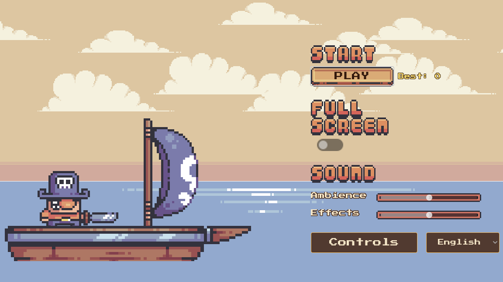
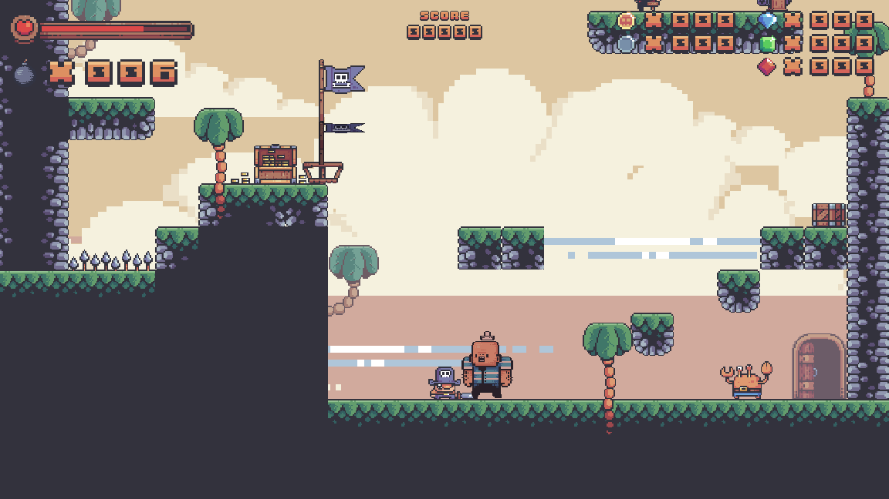
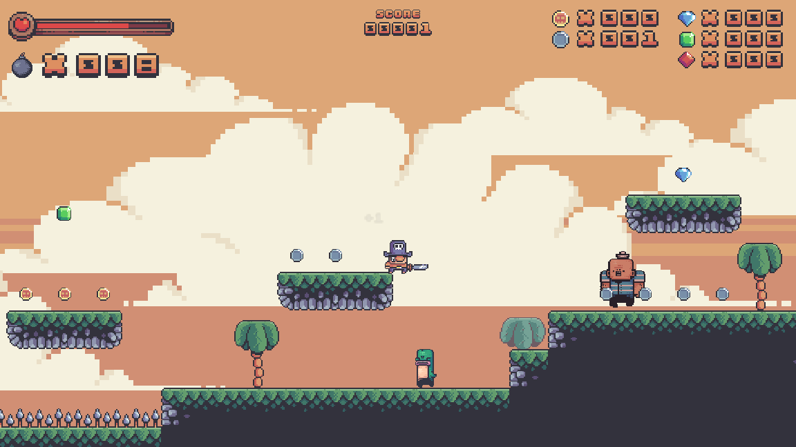
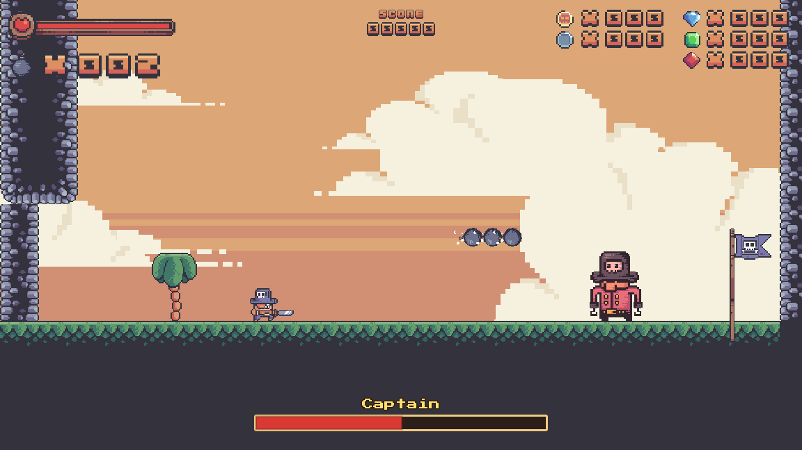
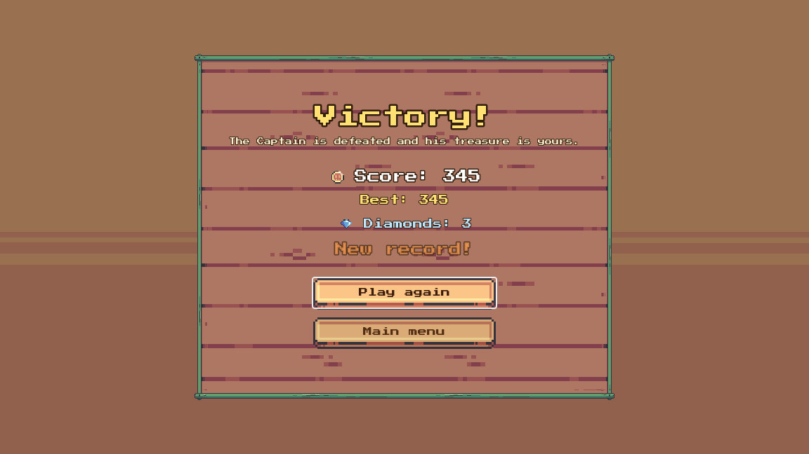
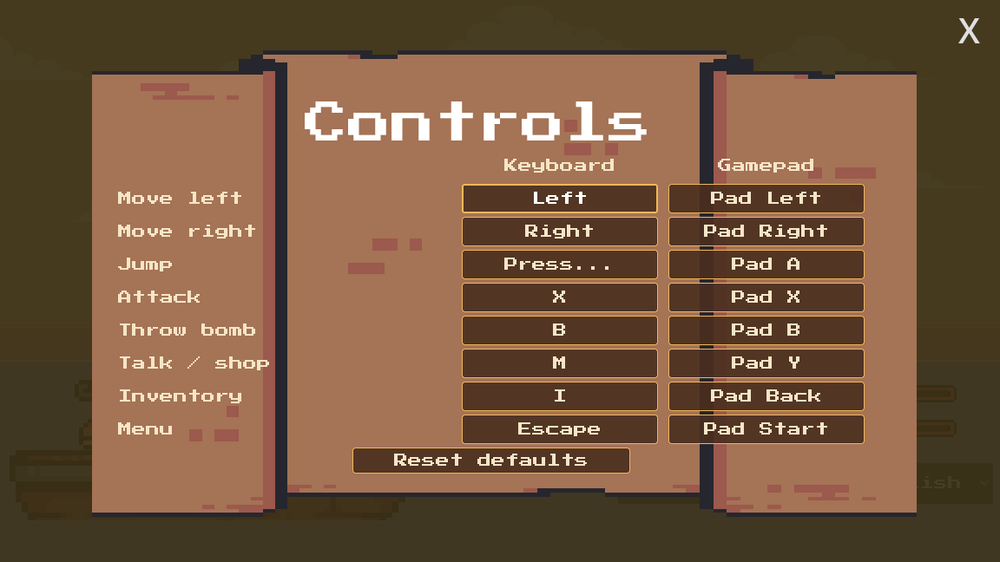

# Plunder Isles

A 2D pirate platformer made with Godot: fight your way across three islands and a
ship's hold, collect treasure, and defeat the Captain to win. Playable in English
and Spanish, with keyboard or gamepad. (The repository keeps its first name,
*Endless New Game*.)



| | |
|---|---|
|  |  |
|  |  |

## Run it

1. Install **Godot 4.7.2 (standard, not .NET)** from the
   [official release](https://github.com/godotengine/godot/releases/tag/4.7.2-stable).
2. Open Godot, choose **Import**, and select `project.godot` in this folder.
3. Press **F5** (Run Project). The project uses the *Compatibility* renderer, so it
   also runs on older GPUs and in the browser.

To build it yourself: **Project → Export** has a *Web* and a *Windows Desktop*
preset (export templates for 4.7.2 required). The
[Export workflow](.github/workflows/export.yml) builds both on every push to
`main` and uploads them as artifacts.

## Controls

Every action can be remapped from **Menu → Controls**, for keyboard and gamepad.
The choices are saved.

| Action | Keyboard | Gamepad |
|---|---|---|
| Move | ← → or A D | D-pad / left stick |
| Jump (up to triple jump) | Space, ↑ or W | A |
| Attack | X or J | X |
| Throw bomb | B or K | B |
| Talk / shop | M or E | Y |
| Inventory (pick a slot with the arrows, use with Enter) | I or Tab, mouse wheel | Back |
| Pause menu | Esc | Start |



## What's in it

- **Four levels** linked by doors, ending in a boss arena. Checkpoint flags save
  your progress inside a level; dying returns you to the last one.
- **Five enemy types**: crabs, a charging bald pirate, a cucumber that puts out your
  lit bombs, and a heavy brute — plus **the Captain**, a two-phase boss with three
  telegraphed attacks.
- **Score and treasure**: silver coins are worth 1, gold 5 and diamonds 25. Finding
  all three diamond colours in one run heals you fully once. The best score is
  saved and shown on the title screen and the victory screen.
- **Shop and power-ups**: buy bombs from a pirate, and use potions from the
  inventory to make your next sword hits one-shot enemies.

## What I learned / technically interesting

- **Game feel as a shared service.** A `GameFeel` autoload provides screen shake,
  hit-stop, particle bursts and floating text. Hit-stop slows `Engine.time_scale`
  and restores it with a token, so overlapping effects never leave the game in slow
  motion — a bug the first version had and a headless test caught.
- **Remappable input that survives restarts.** `Settings` stores only the primary key
  and gamepad button of each action in a `ConfigFile`, swaps bindings that collide,
  and drops default secondary bindings that would trigger two actions at once.
- **Checkpoints without double-counting.** Each pickup is identified by its node
  path inside the level, so reloading at a checkpoint frees the treasure collected
  before it and brings back what was picked up after it, while the HUD is restored
  from a snapshot.
- **Data-driven dialogue and localization.** Dialogues use Dialogue Manager with
  static line IDs, so the same `.dialogue` files are translated through CSV tables
  alongside the UI text.
- **Testing a game headlessly.** Gameplay rules (damage and knock-back, the boss's
  phases, checkpoint respawns, remapping) were verified with scripted runs of the
  real scenes in Godot's headless mode, plus rendered screenshots to check visuals.
- **Original audio from code.** Every sound effect and song is generated by a small
  standard-library Python synthesizer in [`tools/audio`](tools/audio).

## Project layout

```text
assets/        sprites (CC0), font (OFL) and generated sounds
scenes/game/   characters, enemies, levels, UI, dialogues and autoloads (global/)
localization/  UI and dialogue translations (CSV)
tools/audio/   the synthesizer that builds assets/sounds
addons/        Dialogue Manager 4.2.0
```

## Credits

- Art: [Treasure Hunters](https://pixelfrog-assets.itch.io/treasure-hunters) and
  [Pirate Bomb](https://pixelfrog-assets.itch.io/pirate-bomb) by Pixel Frog (CC0).
- Font: Press Start 2P by CodeMan38 (SIL Open Font License 1.1).
- Dialogue system: [Dialogue Manager](https://github.com/nathanhoad/godot_dialogue_manager)
  by Nathan Hoad (MIT).
- Music and sound effects: original, generated with `tools/audio`.

Details and license texts are in [CREDITS.md](CREDITS.md).

## License

The game code is released under the [MIT License](LICENSE). Third-party assets keep
their own licenses, listed in [CREDITS.md](CREDITS.md).
